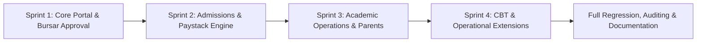

# 📅 Project Plan: School Portal

**Document ID:** DOC-PROJ-002  
**Version:** 1.0.0  
**Date:** November 12, 2026  
**Status:** Approved  
**Author:** Software Engineering Project Management  

---

## 1. Document Control

| Version | Date | Author | Description / Change History | Status |
|---|---|---|---|---|
| 1.0.0 | 2026-11-12 | Lead Architect | Comprehensive Software Lifecycle Project Plan | Approved |

---

## 2. Development Methodology
The project employs an **Agile-Scrum framework** adapted for multi-phase progressive delivery across four structured sprints/phases. Sprints operate on bi-weekly cadences supported by automated continuous integration (CI) tests and git pull-request verification.

---

## 3. Project Timeline & Phase Breakdown

| Phase / Sprint | Focus Area | Deliverables | Milestone Completion |
|---|---|---|---|
| **Phase 1** | Core Portal, Invoicing & Parent Updates | Bank receipt upload, Bursar approval queue, Parent announcements & timetables, Helpdesk ticketing. | **Completed (Commit 8cf68bb)** |
| **Phase 2** | Admissions, Paystack & Public Site | Public landing site, Admissions portal & status tracker, Paystack gateway, Fee-based result lock, Debtors ledger. | **Completed (Commit 838f63b)** |
| **Phase 3** | Academic Workflow & Parent Portal | CA score sheets, Broadsheet, Promotions pipeline, Senior Secondary streams, Parent student linking, Discipline log. | **Completed (Commit 6b53694)** |
| **Phase 4** | Extended Modules & Operations | CBT exam engine, Staff payroll & PAYE, Operating expenses, Sick bay clinic records, Stores inventory, Clubs, External exams registry, PWA manifest. | **Completed (Commit a97648e)** |
| **Phase 5** | Software Engineering Documentation | Complete SRS, SDD, Architecture Diagrams, ERD, Test Plan & Cases, Deployment & Recovery Guides, User Manuals. | **In Progress** |

---

## 4. Team Roles & Responsibilities Matrix (RACI)

| Team Member / Role | Charter & Scope | Requirements & Architecture | Development & APIs | Testing & QA | Deployment & DevOps | User Manuals |
|---|:---:|:---:|:---:|:---:|:---:|:---:|
| **Lead Technical Architect** | Accountable | Accountable | Responsible | Consulted | Accountable | Consulted |
| **Full-Stack Engineers** | Informed | Consulted | Responsible | Responsible | Responsible | Consulted |
| **QA / Test Automation Lead**| Informed | Consulted | Informed | Accountable | Consulted | Consulted |
| **Security & Compliance Lead**| Consulted | Consulted | Consulted | Responsible | Responsible | Informed |
| **Technical Documentation Lead**| Consulted | Responsible | Informed | Informed | Informed | Accountable |

*Legend: R = Responsible, A = Accountable, C = Consulted, I = Informed.*

---

## 5. Communication Plan & Cadence

| Meeting / Event | Frequency | Participants | Objective | Deliverable |
|---|---|---|---|---|
| **Daily Standup** | Mon–Fri (09:00 AM) | Engineering Team | Blockers, daily sprint objectives, PR review status. | Jira / GitHub Project Board update |
| **Sprint Planning** | Bi-weekly | Architect, Product Owner, Engineers | User story grooming, complexity estimation, task assignment. | Sprint Backlog commit |
| **Sprint Review & Demo** | Bi-weekly | All Stakeholders, School Reps | Demonstration of functional increment on staging environment. | Stakeholder feedback log |
| **Sprint Retrospective** | Bi-weekly | Engineering Team | Process improvements, test suite velocity, code quality analysis. | Action items log |

---

## 6. Risk Register & Mitigation Strategy

| Risk ID | Description | Severity | Probability | Impact | Mitigation Strategy | Owner |
|---|---|---|---|---|---|---|
| **RSK-01** | Student result leakage before school fee payment settlement | High | Medium | Financial loss & policy breach | Enforce database-level check (`isClearedForResults`) on all result query APIs and report card renderers. | Backend Lead |
| **RSK-02** | CBT test submission interruption due to sudden student network loss | Critical | High | Lost exam scores & student distress | Implement client-side localStorage state caching with countdown timer sync and automated offline resume. | Frontend Lead |
| **RSK-03** | Counterfeit payment bank teller receipts uploaded by fraudulent accounts | High | High | Unearned financial credit | Double-entry approval requirement: Bursar manual review queue with required transaction reference validation. | Finance Eng |
| **RSK-04** | Database deadlocks during concurrent term-end promotion runs | Medium | Low | Slow query performance | Atomic batch transactions via Prisma with optimistic concurrency control. | Database Admin |

---

## 7. Change Management & Issue Tracking Process
1. **Change Requests (CR):** Submitted via GitHub Issues using structured templates (`Feature Request`, `Defect`, `Security Fix`).
2. **Impact Assessment:** Architect reviews architectural impact, database schema migration requirements, and backward compatibility.
3. **Approval Gate:** Changes affecting core financial calculations or grading formulas require dual sign-off from Bursar and Lead Architect.
4. **Implementation & Testing:** Every change requires automated unit tests verifying regressions before merge to `main`.
