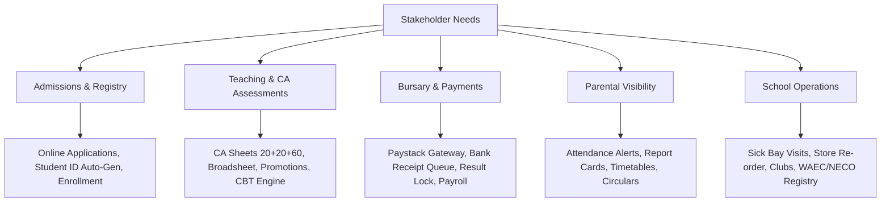

# 📝 Requirements Gathering Document: School Portal

**Document ID:** DOC-REQ-001  
**Version:** 1.0.0  
**Date:** November 12, 2026  
**Status:** Approved  
**Author:** Requirements Engineering & Systems Analysis  

---

## 1. Document Control

| Version | Date | Author | Description / Change History | Status |
|---|---|---|---|---|
| 1.0.0 | 2026-11-12 | Requirements Analyst | Comprehensive stakeholder interviews and elicitations | Approved |

---

## 2. Stakeholder Interviews & Feedback Summary

### 2.1 Principal & School Proprietor Feedback
- *"We need an unforgeable academic report card system. Every term parents dispute manual arithmetic, and students sometimes alter report cards before taking them home."*
- *"We must have strict controls preventing students from viewing results if their term school fees are unpaid, while still allowing bursars to grant discretionary waivers."*

### 2.2 Bursar / Accounting Team Feedback
- *"Parents frequently pay via bank transfer and drop physical paper tellers that get lost or faded. We need parents to upload their receipt slip directly into their portal, allowing our office to verify with our bank statement and click 'Approve' or 'Reject' with feedback."*
- *"We also need to track non-tuition operational disbursements like diesel for generators, science reagents, and facility maintenance with payment voucher numbers."*

### 2.3 Form Masters & Subject Teachers Feedback
- *"Continuous assessment computation is our biggest headache at the end of every term. We need a continuous assessment score sheet where we enter CA 1 (20 marks), CA 2 (20 marks), and Exam (60 marks) with automatic total computation and grade assignment (A1, B2, C4, etc.)."*
- *"Taking daily attendance should be one-click: mark all as present by default, and only change those who are absent or late."*

### 2.4 Parents & Guardians Feedback
- *"I work long hours and cannot visit the school every week. I want to see if my child was in school today, download their exam timetable, check assignments, and pay fees using my debit card or transfer without queuing at the bank."*

### 2.5 Students Feedback
- *"We want to take practice CBT tests online with a countdown timer to prepare for WAEC and JAMB examinations."*
- *"We want to see our homework deadlines and join school clubs like JET Club and Literary & Debate directly."*

---

## 3. Business & Functional Needs Mapping

---

## 4. Non-Functional Requirements (NFR) Baseline
1. **Performance:** Maximum 1.5s server response time for API endpoints under standard loads.
2. **Reliability:** 99.5% uptime during examination weeks and admission cycles.
3. **Security:** Session token encryption, CSRF protection, SQL injection prevention via Prisma parameterization, and strict horizontal authorization.
4. **Usability:** Responsive layout optimized for mobile screens (360px+) through desktop displays (1920px+).

---

## 5. Assumptions, Constraints & Dependencies
- **Assumptions:** Parents and teachers possess smartphone or computer access with modern web browsers.
- **Constraints:** Must comply with Nigerian educational guidelines (Junior WAEC / BECE, Senior WAEC/NECO 9-point grading scale).
- **Dependencies:** Active internet gateway connectivity for Paystack checkout and notification delivery.
