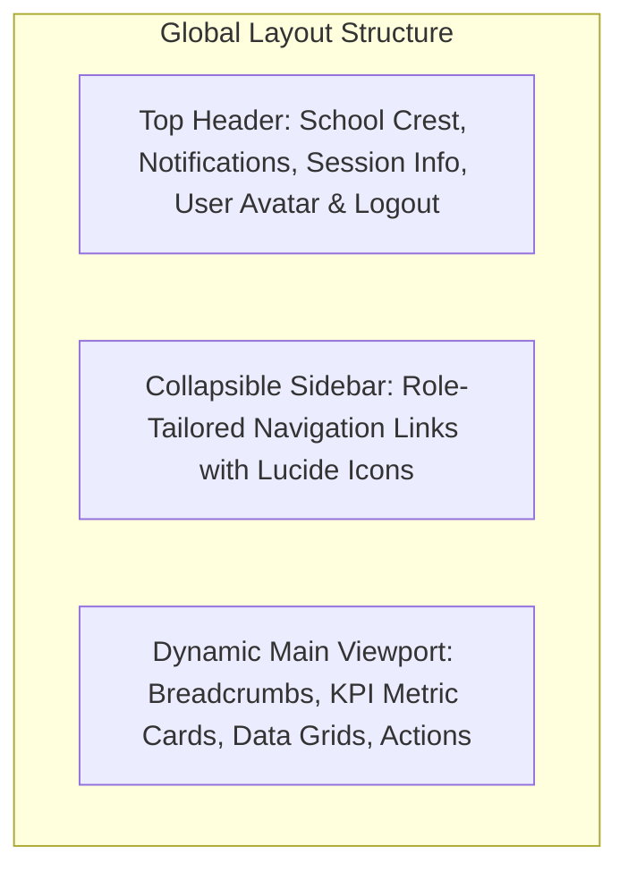

# 🎨 UI/UX Design & Design System: School Portal

**Document ID:** DOC-UI-001  
**Version:** 1.0.0  
**Date:** November 12, 2026  
**Status:** Approved  
**Author:** Frontend & UX Design Team  

---

## 1. Document Control

| Version | Date | Author | Description / Change History | Status |
|---|---|---|---|---|
| 1.0.0 | 2026-11-12 | Principal UX Designer | Comprehensive UI design system, color palette, and layout specs | Approved |

---

## 2. Design Philosophy
The School Portal user experience is designed for clarity, high contrast, low cognitive friction, and seamless performance across low-end mobile devices and high-resolution monitors.

### Design Principles:
1. **Role-Optimized Contexts:** Each user role enters a dedicated visual cockpit highlighting their most urgent tasks (e.g. Bursar sees pending receipts; Teacher sees today's attendance; Parent sees child status and fee balance).
2. **Defensive Status Messaging:** Empty, loading, error, and success states are clearly articulated with icon-annotated banners.
3. **Information Density with Breathing Room:** Compact tabular grids for broadsheets and accounting ledgers paired with whitespace and card elevation.

---

## 3. Color Palette & Typography

### 3.1 Color Palette
- **Primary Navy:** `#1e3a8a` (`blue-900`) — Primary navigation, header cards, institutional identity.
- **Accent Emerald:** `#059669` (`emerald-600`) — Positive financial balances, passing grades, success buttons.
- **Warning Amber:** `#d97706` (`amber-600`) — Pending approvals, re-order threshold warnings, overdue notices.
- **Destructive Rose:** `#e11d48` (`rose-600`) — Outstanding debtors, failed exams, rejection alerts.
- **Neutral Slate:** `#0f172a` (`slate-900`) for text, `#f8fafc` (`slate-50`) for main content background.

### 3.2 Typography
- **Primary Font Family:** Inter, system-ui, -apple-system, sans-serif.
- **Scale:**
  - H1: `24px` / `bold` / `tracking-tight`
  - H2: `18px` / `semibold`
  - Body: `14px` / `regular` / `leading-relaxed`
  - Caption / Badges: `12px` / `medium`

---

## 4. Role-Based Dashboard Layouts

### Dashboard Layout Breakdown:
1. **Admin Dashboard (`/admin`):** Total enrollment KPI, fee collection aggregate, pending admissions counter, teacher headcount, quick links to broadsheets and payroll.
2. **Teacher Dashboard (`/teacher`):** Class timetable widget, today's attendance launcher, pending assignments grading queue, quick CA score sheet access.
3. **Student Dashboard (`/student`):** Weekly timetable cards, active homework assignments, upcoming CBT quizzes, latest terminal grades.
4. **Parent Dashboard (`/parent`):** Multi-child selector pill, child attendance status badge, school fee invoices, report card generator.
5. **Bursar Dashboard (`/admin/fees` & `/admin/fees/approvals`):** Paid vs Outstanding ratio donut chart, Bank receipt approval queue, staff payroll run console.

---

## 5. UI Component Library
- **Tables & Broadsheets:** Striped rows, sticky headers, responsive horizontal scrolling on small screens.
- **Modal Dialogs:** Accessible backdrop blur, keyboard ESC dismissal, focus trapping.
- **Badges:** Semantically colored status pills (`PAID`, `PENDING`, `EXCUSED`, `ACTIVE`).
- **Icons:** Standardized Lucide React iconography (e.g. `GraduationCap`, `CreditCard`, `CheckCircle`, `Calendar`).
