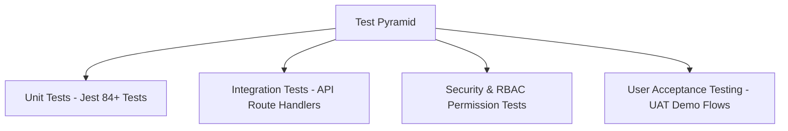

# 🧪 Software Test Plan (STP): School Portal

**Document ID:** DOC-TEST-001  
**Version:** 1.0.0  
**Date:** November 12, 2026  
**Status:** Approved  
**Author:** Quality Assurance & Test Engineering Team  

---

## 1. Document Control

| Version | Date | Author | Description / Change History | Status |
|---|---|---|---|---|
| 1.0.0 | 2026-11-12 | QA Lead | Comprehensive test strategy, test levels, and defect workflows | Approved |

---

## 2. Testing Objectives & Scope
The objective of testing the School Portal is to verify functional compliance, financial calculation accuracy, role-based security isolation, system performance, and responsive usability across all target roles.

### Scope:
- **In-Scope:** Unit testing, integration testing, API contract testing, role-based authorization verification, payment gateway webhook simulation, and mobile responsiveness testing.
- **Out-of-Scope:** Physical hardware clock-in devices, native app store binary testing.

---

## 3. Test Levels & Strategy

1. **Unit Testing:** Tests isolated functions (grade formulas, cumulative GPA, WAEC grade letters, integer Kobo currency conversions, payroll deductions, 8% pension).
2. **Integration Testing:** Tests API routes (`/api/cbt/*`, `/api/fees/*`, `/api/attendance`, `/api/admissions`) with mock database models and audit logging.
3. **Security Testing:** Verifies unauthenticated route blocking, horizontal IDOR protection, CSRF mitigation, and webhook signature verification.
4. **User Acceptance Testing (UAT):** Verifies end-to-end user workflows (e.g. Student taking CBT test, Parent uploading payment receipt, Bursar approving receipt).

---

## 4. Entry & Exit Criteria

### 4.1 Entry Criteria
- Code builds without TypeScript errors (`npx tsc --noEmit` exit code 0).
- Database migrations and seed fixtures successfully initialized.
- Environment variables configured for testing.

### 4.2 Exit Criteria
- 100% of critical and high-priority test cases pass.
- Zero open critical or high-severity security vulnerabilities.
- All test suites passing (`npm test` returns 0 failed suites).

---

## 5. Defect Management & Severity Matrix

| Severity Level | Definition | SLA for Resolution |
|---|---|---|
| **Critical (S1)** | Total system crash, data corruption, financial calculation error, or security breach. | $< 4$ hours |
| **High (S2)** | Major feature broken (e.g. CBT timer failing to submit, report card failing to render). | $< 24$ hours |
| **Medium (S3)** | Minor functional defect with available workaround. | $< 72$ hours |
| **Low (S4)** | Cosmetic UI alignment, typographical errors, minor spacing anomalies. | Next scheduled sprint |
