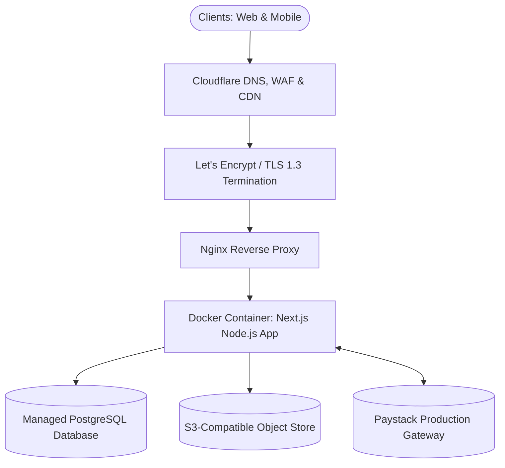

# 🚀 Production Deployment Plan: School Portal

**Document ID:** DOC-OPS-001  
**Version:** 1.0.0  
**Date:** November 12, 2026  
**Status:** Approved  
**Author:** DevOps & Cloud Infrastructure Team  

---

## 1. Document Control

| Version | Date | Author | Description / Change History | Status |
|---|---|---|---|---|
| 1.0.0 | 2026-11-12 | Lead DevOps Engineer | Comprehensive production deployment specifications and CI/CD pipelines | Approved |

---

## 2. Target Hosting Architecture & Topology



---

## 3. Production Environment Requirements
- **Host Server:** Ubuntu 22.04 LTS (Minimum 2 vCPUs, 4GB RAM, 50GB NVMe SSD).
- **Domain & SSL:** Custom fully-qualified domain name (`portal.school.edu.ng`) secured via automated Let's Encrypt SSL/TLS certificates with auto-renewal.
- **Node Runtime:** Node.js v20.x LTS or Docker multi-stage container.
- **Database Engine:** Managed PostgreSQL 15+ instance with automated snapshots enabled.

---

## 4. Multi-Stage Production Dockerfile

```dockerfile
# Stage 1: Dependencies
FROM node:20-alpine AS deps
WORKDIR /app
COPY package*.json ./
COPY prisma ./prisma/
RUN npm ci

# Stage 2: Builder
FROM node:20-alpine AS builder
WORKDIR /app
COPY --from=deps /app/node_modules ./node_modules
COPY . .
RUN npx prisma generate
RUN npm run build

# Stage 3: Runner
FROM node:20-alpine AS runner
WORKDIR /app
ENV NODE_ENV=production
COPY --from=builder /app/public ./public
COPY --from=builder /app/.next/standalone ./
COPY --from=builder /app/.next/static ./.next/static
COPY --from=builder /app/prisma ./prisma

EXPOSE 3000
ENV PORT=3000
CMD ["node", "server.js"]
```

---

## 5. Automated CI/CD Pipeline (GitHub Actions)

```yaml
name: School Portal CI/CD

on:
  push:
    branches: [ main ]
  pull_request:
    branches: [ main ]

jobs:
  verify:
    runs-on: ubuntu-latest
    steps:
      - uses: actions/checkout@v4
      - uses: actions/setup-node@v4
        with:
          node-version: 20
          cache: 'npm'
      - run: npm ci
      - run: npx prisma generate
      - run: npx tsc --noEmit
      - run: npm test

  deploy:
    needs: verify
    if: github.ref == 'refs/heads/main'
    runs-on: ubuntu-latest
    steps:
      - uses: actions/checkout@v4
      - name: Deploy to Production
        run: |
          echo "Deploying verified build to production cluster..."
```

---

## 6. Post-Deployment Verification Checklist
- [ ] Database connection verified and Prisma migrations applied (`npx prisma migrate deploy`).
- [ ] NextAuth secret and session cookies functioning on production domain.
- [ ] Paystack live webhook endpoint registered and HMAC secret configured.
- [ ] File upload directory permissions configured (`chmod 755 public/uploads`).
- [ ] PWA manifest verified in Chrome DevTools Application tab.
- [ ] Health check endpoint (`/api/health`) returning HTTP 200 OK.
