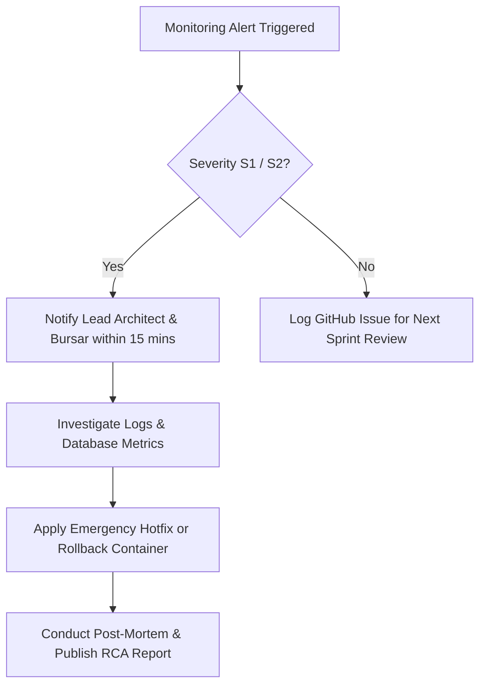

# 🛠️ Operations & Maintenance Guide: School Portal

**Document ID:** DOC-OPS-002  
**Version:** 1.0.0  
**Date:** November 12, 2026  
**Status:** Approved  
**Author:** Site Reliability Engineering (SRE) Team  

---

## 1. Document Control

| Version | Date | Author | Description / Change History | Status |
|---|---|---|---|---|
| 1.0.0 | 2026-11-12 | Lead SRE | System monitoring, incident management, and operational maintenance | Approved |

---

## 2. System Monitoring & Health Checks
- **Application Health Check:** Real-time health endpoint available at `/api/health`. Returns HTTP 200 with server timestamp, database connection status, and memory utilization.
- **Log Monitoring:** Centralized stdout/stderr logging via PM2 or Docker log drivers (`docker logs -f school-portal`).
- **Uptime Monitoring:** External synthetic monitoring (e.g. UptimeRobot / Better Uptime) configured to ping the portal root and `/api/health` every 60 seconds.

---

## 3. Routine Maintenance Schedules

| Task | Frequency | Target Window | Impact |
|---|---|---|---|
| **Database Vacuum & Index Optimization** | Weekly | Sundays 02:00 AM UTC | Zero downtime |
| **Full Database Snapshot** | Daily | Everyday 01:00 AM UTC | Zero downtime |
| **OS & Security Patch Updates** | Monthly | First Saturday 03:00 AM UTC | $< 5$ min restart window |
| **Audit Log Archive & Compression** | Termly | End of each academic term | Zero downtime |

---

## 4. Incident Response & Escalation Workflow

---

## 5. Service Level Expectations (SLA)
- **Portal Availability:** 99.5% availability outside scheduled maintenance windows.
- **Term-End Exam Window:** 99.9% guaranteed uptime during final examination weeks.
- **Support Ticket Resolution:** Urgent financial/result issues addressed within 4 hours; general technical inquiries within 24 hours.
