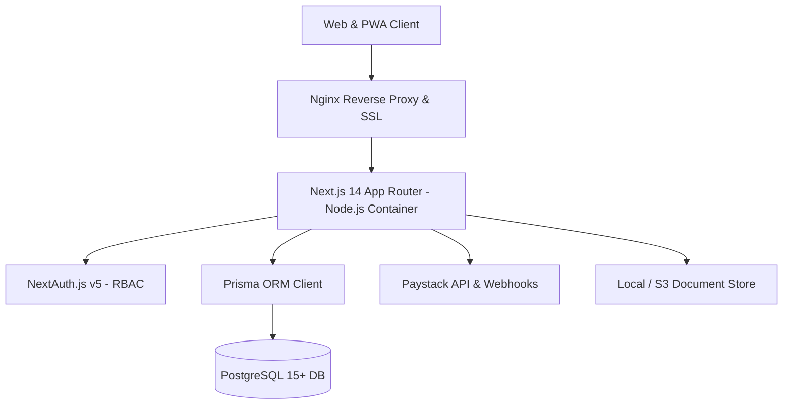

# 📚 School Portal Software Engineering Documentation

Welcome to the definitive software engineering documentation repository for the **School Portal** enterprise school management system.

All documents adhere strictly to standard software development lifecycle (SDLC) engineering standards, IEEE 830-1998 guidelines, and Nigeria Data Protection Act (NDPA) regulatory baselines.

---

## 🗂️ Document Control & Master Index

| Doc ID | Document Title | Description | Version | Status | File Link |
|---|---|---|---|---|---|
| **DOC-PROJ-001** | **Project Charter** | Purpose, objectives, problem statement, stakeholders, scope, risks, and sign-offs. | 1.0.0 | Approved | [01_project_charter.md](./01_project_charter.md) |
| **DOC-PROJ-002** | **Project Plan** | Timeline, milestones, Agile methodology, RACI matrix, and risk register. | 1.0.0 | Approved | [02_project_plan.md](./02_project_plan.md) |
| **DOC-PROJ-003** | **Feasibility Study** | Technical, operational, economic (TCO), legal, and comparative alternatives analysis. | 1.0.0 | Approved | [03_feasibility_study.md](./03_feasibility_study.md) |
| **DOC-REQ-001** | **Requirements Gathering** | Stakeholder feedback, business mapping, non-functional requirements, constraints. | 1.0.0 | Approved | [04_requirements_gathering.md](./04_requirements_gathering.md) |
| **DOC-SRS-001** | **Software Requirements Specification (SRS)** | IEEE 830 compliant requirements across all modules and system interfaces. | 1.0.0 | Approved | [05_software_requirements_specification_srs.md](./05_software_requirements_specification_srs.md) |
| **DOC-USE-001** | **Use Cases Specification** | Detailed flows, preconditions, exceptions, and acceptance criteria for 19 core workflows. | 1.0.0 | Approved | [06_use_cases.md](./06_use_cases.md) |
| **DOC-REQ-002** | **User Stories & Acceptance Criteria** | Agile user stories across Student, Parent, Teacher, and Administrator personas. | 1.0.0 | Approved | [07_user_stories_and_acceptance_criteria.md](./07_user_stories_and_acceptance_criteria.md) |
| **DOC-SDD-001** | **Software Design Document (SDD)** | High-level system architecture, multi-tier diagrams, and component models. | 1.0.0 | Approved | [08_software_design_document_sdd.md](./08_software_design_document_sdd.md) |
| **DOC-DB-001** | **Database Design & ERD** | 3NF relational normalization, Mermaid ERD, table dictionaries, and retention rules. | 1.0.0 | Approved | [09_database_design_and_erd.md](./09_database_design_and_erd.md) |
| **DOC-API-001** | **REST API Design & Specification** | HTTP endpoints, authentication, request/response formats, error handling standards. | 1.0.0 | Approved | [10_api_design.md](./10_api_design.md) |
| **DOC-UI-001** | **UI/UX Design & Design System** | Color palettes, typography, role-based dashboard layouts, and component library. | 1.0.0 | Approved | [11_ui_ux_design.md](./11_ui_ux_design.md) |
| **DOC-SEC-001** | **Security Design & Threat Model** | Authentication flow, STRIDE threat model, RBAC permission matrix, data encryption. | 1.0.0 | Approved | [12_security_design.md](./12_security_design.md) |
| **DOC-DEV-001** | **Technical & Engineering Guidelines** | Tech stack, folder structure, git branching, coding conventions, error handling. | 1.0.0 | Approved | [13_technical_documentation.md](./13_technical_documentation.md) |
| **DOC-DEV-002** | **Database Setup & Operations** | Migration workflow, seed script instructions, backup and restoration commands. | 1.0.0 | Approved | [14_database_documentation.md](./14_database_documentation.md) |
| **DOC-DEV-003** | **Source Code & Developer Setup** | Quickstart onboarding guide, testing commands, and build instructions. | 1.0.0 | Approved | [15_source_code_documentation.md](./15_source_code_documentation.md) |
| **DOC-TEST-001** | **Software Test Plan (STP)** | Testing strategy, levels, entry/exit criteria, and defect severity classification. | 1.0.0 | Approved | [16_software_test_plan.md](./16_software_test_plan.md) |
| **DOC-TEST-002** | **Software Test Cases Matrix** | 21 comprehensive test cases across all critical functional modules with results. | 1.0.0 | Approved | [17_test_cases.md](./17_test_cases.md) |
| **DOC-TEST-003** | **Test Summary & Defect Report** | Regression results (84/84 passing tests), defect log, and QA sign-off. | 1.0.0 | Approved | [18_test_reports.md](./18_test_reports.md) |
| **DOC-OPS-001** | **Production Deployment Plan** | Docker containerization, CI/CD pipeline, SSL, and post-deployment checklist. | 1.0.0 | Approved | [19_deployment_plan.md](./19_deployment_plan.md) |
| **DOC-OPS-002** | **Operations & Maintenance Guide** | Monitoring endpoints, routine maintenance schedule, SLAs, and incident runbooks. | 1.0.0 | Approved | [20_operations_and_maintenance_guide.md](./20_operations_and_maintenance_guide.md) |
| **DOC-OPS-003** | **Disaster Recovery Plan** | RTO/RPO targets, database failure failover runbooks, and emergency contacts. | 1.0.0 | Approved | [21_disaster_recovery_plan.md](./21_disaster_recovery_plan.md) |
| **DOC-USR-001** | **User Manuals & Quickstart Guides** | Step-by-step role manuals (Student, Parent, Teacher, Admin) and 1-page quick guides. | 1.0.0 | Approved | [22_user_manuals_and_quickstart.md](./22_user_manuals_and_quickstart.md) |

---

## 🏛️ System Architecture High-Level Overview

---
*Maintained by the Software Architecture & Engineering Documentation Team.*
